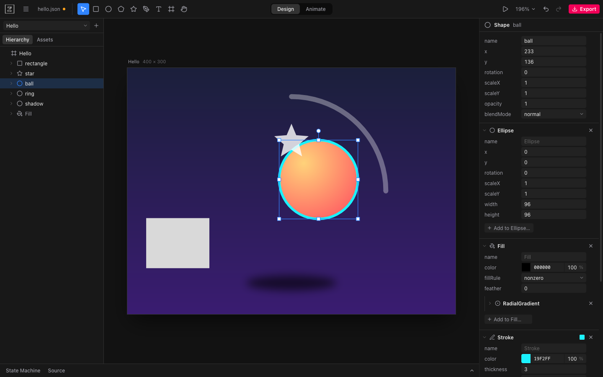

# Zuri editor

The authoring app for Zuri documents: artboards, shapes, animations, state machines and
data binding. It is a Tauri v2 desktop app whose UI (Vite + React 19 + TypeScript) also
runs unchanged in a plain browser tab.

The stage is drawn by the real Zuri runtime (`@seedexr/zuri`, the `zuri-editor.wasm`
build), so what you see is what ships.



More screenshots: [Animate mode](docs/screenshots/animate.png),
[state machine](docs/screenshots/state-machine.png),
[state machine preview](docs/screenshots/preview.png),
[source](docs/screenshots/source.png).

## Run

All commands from the repository root unless noted. `pnpm install` once first; the editor
depends on the workspace package `@seedexr/zuri`, whose `dist/` must be built
(`pnpm --filter @seedexr/zuri build`).

```bash
# Browser (no Tauri): http://localhost:5183
pnpm --filter ./apps/editor dev
#   dev hook: http://localhost:5183/?example=button opens examples/button.json

# Desktop app, development (starts the dev server itself; port 5183 must be free)
cd apps/editor && pnpm tauri dev

# Checks
pnpm --filter ./apps/editor typecheck      # tsc --noEmit
pnpm --filter ./apps/editor test           # node --test, runs the .ts files directly
pnpm --filter ./apps/editor build          # typecheck + vite build -> apps/editor/dist

# Desktop app, release bundle
cd apps/editor && pnpm tauri build

# Rust side only
cd apps/editor/src-tauri && cargo build
```

In a browser, Open uses a file input and Save / Export download a file. Importing SVG and
3D models, shader translation and the full build (`@path` assets) need the desktop app,
and the UI says so.

App icons are generated from the brand logo:
`cd apps/editor && pnpm tauri icon ../../brand/zuri-logo-1024.png`.

## Architecture

**The document is the JSON source tree.** In memory a node is
`{ id, type, props, children }` (`src/doc/model.ts`); `id` is editor-only and never saved.
Opening parses JSON source (or decompiles a `.zur` with `runtime.decompile`), saving
writes JSON source back. The tree is immutable: every edit returns a new tree that shares
the untouched branches, so an undo step is a reference to an old tree.

**One store** (`src/store.ts`, plain TypeScript + `useSyncExternalStore`) holds the
document, selection, active artboard, mode, tool, view, playback state and undo history.
Everything the UI can do is a function in `src/actions.ts`. Property writes go through
`writeProps` there, which is where auto-key lives: in Animate mode a number or color
property of a scene object becomes a `Key` at the playhead instead of a new base value.

**The preview is the runtime** (`src/stage/preview.ts`). On every document change, once
per animation frame: serialize, `runtime.compile`, `runtime.load`, instantiate the active
artboard, `instance.render(w, h, { view })`, `putImageData`. If the document does not
compile, the last good frame stays and the error (with its JSON path) is shown on the
stage. There is no seek call in the runtime, so a frame of an animation is a fresh
instance advanced by `frame / fps`; timeline playback just moves the store's playhead. A
state machine preview keeps one instance, advances it every frame and forwards the
pointer to it.

**Pre-order index = runtime object id.** The compiler emits objects in depth-first
pre-order of the JSON tree, so a node's runtime id is its pre-order index in the whole
document (`indexOf` / `atIndex` in `src/doc/model.ts`, checked against the runtime in the
tests). That maps `instance.hitTest()` to nodes and nodes to `instance.bounds()` /
`instance.worldMatrix()` for the selection box and handles. Overlays are SVG on top of
the canvas, positioned with the view matrix; nothing is baked into the runtime render.

**The inspector is driven by the schema** (`runtime.schema()`): property kinds pick the
control, docs become tooltips, `parents` decides what can be added or dropped where. Three
facts the schema JSON does not carry are mirrored by hand in `src/doc/schema.ts` (which
types are scene objects, which class each reference property points at, which asset type
each `asset` wants).

| Path | Owns |
|---|---|
| `src/doc/` | Framework-free document logic, unit-tested: `model` (tree, JSON, ids), `schema` (typed schema, references), `refs` (naming, rename, delete with dependents), `autokey` (keys, sampling), `ops` (new objects, group, duplicate, import merge, pen paths), `color`, `jsonpath` (error path to source line) |
| `src/store.ts`, `src/actions.ts`, `src/shortcuts.ts`, `src/runtime.ts` | State, commands, keyboard, runtime + schema loading |
| `src/stage/` | `preview` (compile + render loop), `Stage` (canvas, overlay, input), `gestures` (move, resize, rotate, marquee, create), `handles` (selection geometry), `matrix` |
| `src/panels/` | `Toolbar`, `Hierarchy`, `Assets`, `Inspector`, `PropControl` (one control per schema kind), `Source`, `fields`, `ui`, `icons` |
| `src/timeline/` | Timeline: animation settings, ruler, playhead, tracks, keys |
| `src/machine/` | State machine tab: `graph` (auto-layout), `Machine` (graph, view model, listeners, events) |
| `src/io/` | `files` (new, open, save, export), `assets` (image, font, SVG / 3D import), `tauri` (dialogs and Rust commands) |
| `src-tauri/` | The desktop shell, its own Cargo workspace: file read / write, `import_file`, `translate_shader`, `export_zur` (calls `zuri-import`) |

## Styling

Tailwind v4, through the shared brand tokens. `src/styles.css` is the only stylesheet: it
imports `tailwindcss`, then `brand/tokens.css` (the colour, font and radius custom
properties) and `brand/tailwind.css` (the `@theme` that maps them to utilities such as
`bg-panel`, `text-fg-dim`, `border-line`, `ring-accent`). Components are styled with
utility classes in the JSX. The stylesheet adds only body defaults, the global
`:focus-visible` ring, scrollbars and three `@utility` rules used across panels (`field`,
`field-input`, `empty`) plus `checker`.

No colour is hard-coded in the editor: change a value in `brand/tokens.css` and the app
follows (the one exception is drop shadows, which use Tailwind's `black`). Roles: neutral dark surfaces; blue (`accent`) for selection, focus, the active
tool and the playhead; cyan (`key`) for keys and animated-property indicators; pink
(`brand`) only for the Export button; red / amber / green for errors, unsaved changes and
success. Geometry that has to be computed (canvas overlay, timeline positions, panel
sizes) is inline style. Icons are `lucide-react` only. Fonts are `font-ui` / `font-mono`
from the theme (Inter / JetBrains Mono when installed, system fonts otherwise; none are
bundled).

## Keyboard shortcuts

`Cmd` on macOS, `Ctrl` elsewhere. Shortcuts are ignored while typing in a field, except
the file ones.

| Key | Action |
|---|---|
| `V` | Select tool |
| `R` / `O` | Rectangle / Ellipse tool (Polygon and Star are in the toolbar) |
| `P` | Pen tool: click = corner, click-drag = curve, click the first point to close, `Enter` / `Esc` / double-click to finish |
| `T` | Text tool (needs an imported font) |
| `A` | Artboard tool |
| `H`, hold `Space`, middle-drag | Pan |
| Wheel | Pan. `Cmd/Ctrl` + wheel or pinch: zoom about the cursor |
| `Shift+1` | Zoom to fit |
| `Cmd/Ctrl+0`, `Cmd/Ctrl+=`, `Cmd/Ctrl+-` | Zoom to 100%, in, out |
| `Cmd/Ctrl+Z`, `Shift+Cmd/Ctrl+Z` (or `Ctrl+Y`) | Undo, redo |
| `Delete` / `Backspace` | Delete the selection (objects, keys, states, transitions...) |
| `Cmd/Ctrl+D` | Duplicate |
| `Cmd/Ctrl+G` | Group into a `Node` |
| Arrow keys, with `Shift` | Nudge by 1, by 10 |
| `Shift+Space` | Play / pause the animation, or start / stop the state machine preview |
| `Esc` | Finish the pen path, stop the preview, back to the Select tool, clear the selection |
| `Cmd/Ctrl+S`, `Shift+Cmd/Ctrl+S` | Save, Save As (JSON source) |
| `Cmd/Ctrl+O`, `Cmd/Ctrl+N`, `Cmd/Ctrl+E` | Open, New, Export `.zur` |
| `Cmd/Ctrl+Enter` (Source tab) | Apply the JSON |
| Stage modifiers | `Shift`: add to selection, constrain a move to an axis, keep proportions, snap rotation to 15 degrees. `Alt`: resize from the center. `Cmd/Ctrl`-click: select the object under the pointer directly. Double-click: one level deeper |
| Hierarchy rows | `Enter` select, `F2` or double-click rename, arrows move focus / expand / collapse |

## Status

Checked on 2026-11-15. "Verified" means driven in Chromium against the dev server and
observed (DOM state, screenshots, console without errors or warnings), unless it says
otherwise.

**Verified**
- Shell: toolbar, left / bottom / inspector panels, panel resizers, mode switch, zoom to fit (also refits when the stage resizes while the view is untouched).
- Stage: renders `examples/hello.json` and `examples/button.json`; click-select, drag-move, resize and rotate handles (one undo step each, undo restores); Rectangle tool; Pen tool (open path with a curve, closed path); Artboard tool; Text tool (and its "import a font first" message).
- Hierarchy: select, rename by double-click (track targets follow), expand, group, duplicate (unique names), delete, drag to reorder and reparent; a drop the schema forbids (a Fill into a Node) is not made a child.
- Inspector: number, text, select and color-hex controls; inline child cards; adding a Condition to a Transition; key indicators in Animate mode.
- Animate mode: ruler scrub by click and by drag; auto-key from a stage drag and from the inspector (new tracks and keys appear, base values are kept); play / pause.
- State machine tab: graph with transition labels; add a state; connect two states by dragging; edit blend / condition input / op; add a view-model property and a listener; preview on the stage with hover, press and click reaching the machine, live property values updating and the emitted event listed.
- Source tab: compiler error with its line marked, Apply disabled while invalid, pasted document applied, undo restores the previous document.
- Files (browser): open an example, Save (the download passes `zuri validate`), Export `.zur` (the download passes `zuri validate`), leaving with unsaved changes asks first.
- Assets (browser): import a TTF font and a PNG image; both draw on the stage.
- Unit tests (`pnpm test`, 16 tests) for the document modules, run against the real runtime.
- Desktop: `cargo build` in `src-tauri`, `pnpm tauri info`, and `pnpm tauri dev` opens a window that shows the editor with the default document.

**Built, not verified**
- Desktop only: the native open / save dialogs, reading and writing files, SVG / OBJ / glTF / GLB / FBX import and its merge into the artboard, shader translation, export through `zuri-import`'s `build`, the release bundle, and the production content security policy in `tauri.conf.json` (development runs without one).
- Opening a `.json` or `.zur` from disk in the browser, and New.
- Timeline: dragging keys to retime, selecting a key to edit interpolation and easing, deleting keys and tracks, adding / renaming / deleting animations.
- State machine: adding layers and machines, blend states, writing live values and firing triggers during a preview (reading them is verified).
- Stage: marquee selection, double-click and `Cmd/Ctrl`-click selection, the `Shift` / `Alt` modifiers, wheel pan and zoom, `Space` pan, Polygon and Star tools.
- Inspector: drag-to-change on labels, the system color picker, gradient and gradient-stop cards, Bind cards, the key toggle button.
- Hierarchy keyboard navigation other than what is listed above.

**Not built**
- Shader paints in the preview (no `ShaderHost`): they draw with the parent paint's color.
- Editing the points of an existing path (the pen only creates), snapping and guides, ungroup, copy / paste.
- Showing several artboards on the stage at once: only the active one is drawn.
- Highlighting the current state while previewing (the runtime does not expose it).
- Timeline zoom (the duration always fits the panel width).
- An unsaved-changes prompt when closing the desktop window.
